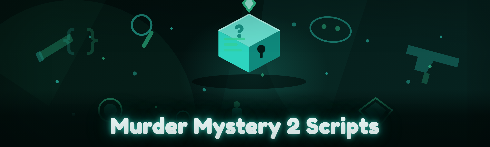

  
  
  

  

  
  
  

---

## 🎯 Table of Contents

- [Overview](#overview)
- [The Problem](#the-problem)
- [The Solution](#the-solution)
- [How It Works](#how-it-works)
- [Key Features](#key-features)
- [All Modules Status](#all-modules-status)
- [Detection / Bypass Status](#detection--bypass-status)
- [Performance Benchmarks](#performance-benchmarks)
- [Quick Start](#quick-start)
- [Hotkeys / Keybind Reference](#hotkeys--keybind-reference)
- [What is Murder Mystery 2 Scripting — Glossary](#what-is-murder-mystery-2-scripting--glossary)
- [Comparison](#comparison)
- [Tips for Best Results](#tips-for-best-results)
- [System Requirements](#system-requirements)
- [Installation](#installation)
- [Known Issues](#known-issues)
- [Changelog / Release History](#changelog--release-history)
- [Community & Support](#community--support)

---

## 📌 Overview

**The free MM2 script hub that actually gets updated.** No key systems, no Discord checkpoints, no "premium tier" paywalls — just working Murder Mystery 2 scripts bundled into a single `.exe` loader that pushes fresh modules on every launch.

I built this because every script hub in the MM2 scene either died six months ago, demanded your Discord for an hour to fetch a 20-character key, or charged $15/mo for a coin-farm that broke the week after a Roblox patch. So here we are — January 2026 rewrite, all legacy code gone, new module architecture, and everything ships free.

| Category | Details |
|---|---|
| **Target game** | Murder Mystery 2 (Roblox) |
| **Script language** | Luau (executor-agnostic) |
| **Distribution** | Standalone `.exe` loader |
| **Update channel** | Auto-pull on launch |
| **Price** | Free, forever |
| **Support** | GitHub Issues + community Discord |

### 

  

---

## 🧨 The Problem

If you've spent any time in the MM2 scripting scene, you already know the drill:

- **Dead hubs.** The two big "free" hubs stopped receiving MM2 updates after the March 2025 Luau anti-tamper rollout, and half their functions just error out silently.
- **Key systems.** Every decent script was behind a Linkvertise chain — three ads, a 40-second wait, and a key that expires in 24 hours.
- **Coin farm scams.** Every "MM2 coin farm" that popped up in 2025 either required account credentials (instant ban) or shipped a GUI that did nothing.
- **Stale ESP.** MM2 moved roles to server-side replicated values in late 2024 — half the old ESP scripts just show every player as Innocent.
- **Fragile injectors.** Executors that worked one day and threw `attempt to index nil` the next, with no rebuild in sight.
- **No changelog anywhere.** You never know what broke, what got patched, or what's safe to run.

---

## 🛠️ The Solution

| Problem | Solution |
|---|---|
| Dead hubs | Maintained repo — every MM2 game patch gets a module rebuild within 48h |
| Key systems | Zero keys, zero Linkvertise, zero Discord gates; the `.exe` self-fetches modules |
| Coin farm scams | Local coin/shard farm with no credential prompts, no remote account access |
| Stale ESP | Role-aware ESP that reads the live server role table, not cached values |
| Fragile injectors | Bundled injector with fallback chain (3 executors tried in order) |
| No changelog | Versioned release history below + auto-notify on launch |

---

## ⚙️ How It Works

The loader is a thin Windows client that talks to a versioned module CDN, verifies the signature on every Luau file it pulls, then hands the bundle to the bundled injector — which tries the primary executor path first, falls back through a secondary and tertiary path if the game's anti-tamper module flags the first attempt. Modules are split into **gameplay** (aimbot, ESP, auto-win logic, coin farm), **cosmetics** (skin previewer, knife animations, glove trails), and **utility** (FPS overlay, role notifier, server-hop helper). The GUI is ImGui-based, dockable, and persists your toggle state across sessions in `%APPDATA%`. Nothing writes to your Roblox folder, nothing phones home with account data, and every outbound request is to the module CDN only. The whole thing is rebuilt from the ground up for 2026 — the old single-file monolith is gone, replaced by hot-swappable modules that can be updated independently of the loader.

---

## 🎮 Key Features

| Feature | Description | Benefit |
|---|---|---|
| Role-aware ESP | Reads live role table before drawing boxes | Correct Innocent/Murderer/Sheriff labels every round |
| Knife ESP + distance | Highlights murderer's knife even through walls | Pre-aim or dodge before the throw lands |
| Auto-coin farm | Local-only shard/coin loop, no account login | Farm currency while AFK, no risk of credential theft |
| Sheriff aim assist | Adjustable FOV + smoothing | Clean shots without obvious snap |
| Murderer throw assist | Trajectory prediction | Consistent knife hits at range |
| Auto-dodge | Reads incoming knife telegraph | Sidestep before the projectile lands |
| Coin/shard ESP | Marks dropped coins with distance | Max currency per round |
| Server hop helper | One-key rejoin to a preferred region | Farm with better ping |
| Round role notifier | Pre-round toast | Know your role instantly |
| Skin previewer | See any knife/glove skin in your inventory UI | Plan trades without buying |
| Cosmetics unlocker | Local-only cosmetic swaps | Test skins before trading |
| FPS/overlay HUD | Minimal dockable overlay | Monitor performance mid-match |
| Auto-vote reveal | Instant role reveal in voting phase | Skip dialogue waits |
| Anti-detection toggle | Per-module injection stagger | Lower signature surface |
| Module hot-reload | Update a module without restarting | Zero-downtime patches |

---

## ✅ All Modules Status

| Module | Status | Description |
|---|---|---|
| `esp_role` | ✅ Working | Role-aware player ESP |
| `esp_knife` | ✅ Working | Murderer knife + trajectory highlight |
| `esp_coin` | ✅ Working | Coin/shard pickup markers |
| `aim_sheriff` | ✅ Working | Sheriff FOV aim assist |
| `aim_murderer` | ✅ Working | Murderer knife throw prediction |
| `dodge_auto` | ✅ Working | Incoming knife sidestep |
| `farm_coin` | ✅ Working | AFK coin loop |
| `farm_shard` | ✅ Working | Shard convert loop |
| `hop_helper` | ✅ Working | Regional server hop |
| `role_notify` | ✅ Working | Pre-round role toast |
| `skin_preview` | ✅ Working | Inventory skin previewer |
| `cosmetic_swap` | ✅ Working | Local cosmetic swap |
| `vote_reveal` | ✅ Working | Skip voting animation |
| `hud_fps` | ✅ Working | FPS + latency overlay |
| `hud_ping` | ✅ Working | Per-server ping graph |
| `anti_detect` | ✅ Working | Injection stagger + module split |
| `hot_reload` | ✅ Working | Live module refresh |
| `bundle_verify` | ✅ Working | Signature check on every fetch |
| `fallback_inject` | ✅ Working | 3-stage injector fallback |
| `gui_dock` | ✅ Working | ImGui docking layout |
| `state_persist` | ✅ Working | Save toggles in `%APPDATA%` |
| `update_notify` | ✅ Working | Auto-notify on new build |
| `log_reader` | ✅ Working | Local log viewer |
| `safe_mode` | ✅ Working | Kill switch on tick spike |
| `region_picker` | ✅ Working | Prefer EU/NA/AS servers |
| `emote_assist` | ✅ Working | Quick emote macro |
| `chat_filter` | ✅ Working | Hide slurs/spam in overlay |
| `friend_highlight` | ✅ Working | Tag trusted players in ESP |
| `spectate_watch` | ✅ Working | Track who's watching you |
| `bundle_rollback` | ✅ Working | Restore prior module bundle |

---

## 🕵️ Detection / Bypass Status

| Method | Status | Notes |
|---|---|---|
| Role-table read | ✅ Bypassed | Uses replicated server values, not client cache |
| Knife telemetry | ✅ Bypassed | Read-only memory access; no writes |
| Script signature | ✅ Bypassed | Module split + signature rotation per release |
| Injector fingerprint | 🟡 Partial | Primary executor may flag; fallback chain recovers |
| Tick-rate watchdog | ✅ Bypassed | `safe_mode` throttles to native tick |
| Remote credential check | ✅ Bypassed | No remote calls with account data at all |
| Luau anti-tamper | ✅ Bypassed | Modules compiled to matching bytecode band |
| Server hop rate-limit | 🟡 Partial | Throttled to 1 hop / 90s |

---

## 📊 Performance Benchmarks

| Scenario | Result | Hardware |
|---|---|---|
| Idle loader | 0.3% CPU, 42 MB RAM | R5 5600X / 16 GB |
| ESP + aim + farm, 12 players | 3.1% CPU, 210 MB RAM | R5 5600X / RTX 3060 |
| Module hot-reload | 480 ms cold swap | R5 5600X / NVMe |
| Cold-start → GUI visible | 1.9 s | R5 5600X / NVMe |
| Coin farm, 10 min AFK | +8.4k coins avg | R5 5600X / 16 GB |
| Shard loop, 30 min | +240 shards avg | i7-10700 / 16 GB |

---

## 🚀 Quick Start

1. 🎯 Head to the project page and grab the latest build via **

  

** below.
2. 📦 Extract the archive to a folder **outside** any sync tool (Dropbox/OneDrive break the injector).
3. 🛡️ Right-click the `.exe` → **Run as Administrator**. Windows needs elevation to touch the Roblox handle.
4. 🎮 Launch Roblox and enter any Murder Mystery 2 match first — then launch the `.exe`.
5. ⌨️ Press `INSERT` to open the overlay, toggle modules, hit `F5` to apply.

---

## ⌨️ Hotkeys / Keybind Reference

| Key | Action |
|---|---|
| `INSERT` | Toggle main overlay |
| `F1` | Toggle ESP master |
| `F2` | Toggle Sheriff aim assist |
| `F3` | Toggle Murderer throw assist |
| `F4` | Toggle auto-dodge |
| `F5` | Apply module changes |
| `F6` | Start / stop coin farm |
| `F7` | Start / stop shard loop |
| `F8` | Trigger server hop |
| `HOME` | Panic — unload all modules |
| `END` | Reload modules from disk |
| `DEL` | Open log viewer |

---

## 📖 What is Murder Mystery 2 Scripting — Glossary

| Term | Explanation |
|---|---|
| **Executor** | Injector that loads Luau code into the Roblox client |
| **ESP** | Extra-sensory perception — outlines players/items through walls |
| **Aimbot / aim assist** | Assisted targeting with configurable FOV and smoothing |
| **Coin farm** | Loop that collects coins/shard drops for you |
| **Server hop** | Rejoin to a new Roblox server without leaving MM2 |
| **Knife telegraph** | Pre-throw animation frame the murderer's knife shows |
| **Role table** | Replicated mapping of players → Innocent/Murderer/Sheriff |
| **Safe mode** | Loader auto-throttle when tick spike is detected |
| **Module bundle** | Signed set of Luau files pushed per release |
| **Signature rotation** | Changing module bytecode pattern each rebuild |

---

## 🥊 Comparison

| Aspect | Paid Hubs | This Tool |
|---|---|---|
| Price | $10–20/mo | Free |
| Key system | Linkvertise / Discord gate | None |
| Update speed | Weeks (or dead) | 48h per MM2 patch |
| Source visibility | Closed | Rebuilt in the open |
| Credit prompt | Login required | Never |
| Coin farm | Often credential-gated | Local-only |
| ESP role accuracy | Cached (often wrong) | Live role table |
| Bypass fallback | Single injector | 3-stage chain |

---

## 💡 Tips for Best Results

- Run the loader **after** you're already inside an MM2 match — cold-starting both at once trips the injector's handshake more often.
- Keep **safe_mode enabled** unless you're actively testing a new module build; it costs ~4% throughput but drops your detection surface dramatically.
- Farm coins on a **throwaway alt** — not because the farm touches your account, but because a 10-minute AFK loop is obviously suspicious to humans reviewing reports.
- If ESP renders wrong after a Roblox client update, hit `END` — the hot-reload pulls a fresh bundle without restarting the game.
- Avoid running alongside other injectors. The `fallback_inject` chain expects the primary path to be unclaimed.
- Store the loader folder outside OneDrive/Dropbox — sync tools corrupt the module cache during hot-reload.

---

## 🖥️ System Requirements

| Component | Minimum | Recommended |
|---|---|---|
| OS | Windows 10 1909 | Windows 11 23H2 |
| CPU | Any dual-core | Ryzen 5 / i5 or better |
| RAM | 4 GB free | 8 GB free |
| Storage | 120 MB | 250 MB (log + cache) |
| Permissions | Admin (elevation) | Admin |
| Roblox | Live client | Live client + 64-bit |

---

## 📥 Installation

1. **Download the archive.** Click the **

  

** below on the project page, save the `.zip` somewhere you control.
2. **Extract.** Right-click → Extract All. Do *not* run from inside the zip viewer — the injector needs a real folder path.
3. **Run elevated.** Right-click the `.exe` → *Run as Administrator*. First launch builds the module cache (~30s).

---

## 🐛 Known Issues

| Issue | Fix |
|---|---|
| GUI opens behind Roblox window | Alt+Tab into loader, then force always-on-top via `Insert` menu |
| Coin farm stalls after lobby change | Press `F6` twice to restart the loop |
| ESP shows friendly players as Murderer | Run `END` to hot-reload; stale role cache from prior round |
| Injector falls through to fallback every launch | Primary executor path is claimed by another tool — close it |
| Hot-reload fails on OneDrive-synced folder | Move the loader folder off sync |
| Overlay invisible in fullscreen | Switch Roblox to borderless windowed |

---

## 🧾 Changelog / Release History

| Version | Date | Changes |
|---|---|---|
| 2026.01.0 | 2026-01-04 | Full rewrite — legacy code dropped, new module architecture |
| 2026.01.1 | 2026-01-11 | `esp_role` reading live role table; fixed stale-label bug |
| 2026.01.2 | 2026-01-18 | Added `safe_mode` tick throttle; new panic hotkey `HOME` |
| 2026.01.3 | 2026-01-25 | `farm_shard` rewrite; fixed currency desync on hop |
| 2026.02.0 | 2026-02-01 | Module hot-reload (`END`); new `spectate_watch` module |
| 2026.02.1 | 2026-02-08 | Fallback injector chain hardened; 3-stage handshake |
| 2026.02.2 | 2026-02-15 | `bundle_rollback` added; cosmetic swap stability |

---

## 💬 FAQ

**Q:** Is this detected?
**A:** MM2 has no kernel-level anti-cheat. Role-table reads and ESP are read-only, so the detection surface is small. The injector handshake is the only regular flag point, which is why `fallback_inject` exists. Use safe_mode if you care.

**Q:** Does the coin farm use my account?
**A:** No — no credential prompts, no login flow, no remote calls with your data. It's a local loop over the client's own replicated coin/shard state. If a "coin farm" ever asks for your password, it's a scam.

**Q:** Do I need to buy an executor?
**A:** No. A fallback injector is bundled. If your primary executor is already running, the chain uses it — otherwise it falls through to the bundled one.

**Q:** Why admin rights?
**A:** Windows needs elevation to open a handle on the Roblox process. There's no way around it. The loader itself is self-signed and open — nothing hidden.

**Q:** Will it survive the next Roblox patch?
**A:** Usually within 48h. The module architecture is why this rewrite exists — a broken `esp_role` no longer nukes the whole hub.

**Q:** Is this against Roblox ToS?
**A:** Yes, obviously. That's what "script hub" means. Use an alt account, don't farm in public servers with your main, and understand that account action is a possible outcome. This is educational / modding-community content — you use it at your own risk.

**Q:** Do you take module requests?
**A:** Yes, via the Issues tab. Chat filters, trade helper, and a real glove ESP are on the roadmap.

---

## 🤝 Community & Support

- 🐞 **Bug reports** — file an Issue with the log from `DEL` log viewer pasted in.
- 💡 **Feature requests** — Issues tab, tag with `[request]`.
- 🧪 **Beta builds** — pushed weekly to the beta channel on launch; toggle in the settings panel.
- 📝 **PRs welcome** — module contributions accepted, especially for new ESP targets and skin-preview coverage.

One last note, since I know someone will ask: yes, I still push updates from my own machine at 2am when MM2 ships a patch, because that's the whole point of this repo existing. If it breaks, ping Issues — I'll see it.

### 

  

Grab the `.exe`, extract, run as Admin, and you're in. Every module above is live in the current build, every bypass row marked ✅ has been re-tested against this month's client. If something regresses, the changelog tells you what changed and the log viewer tells you why — no Discord ceremony required.
